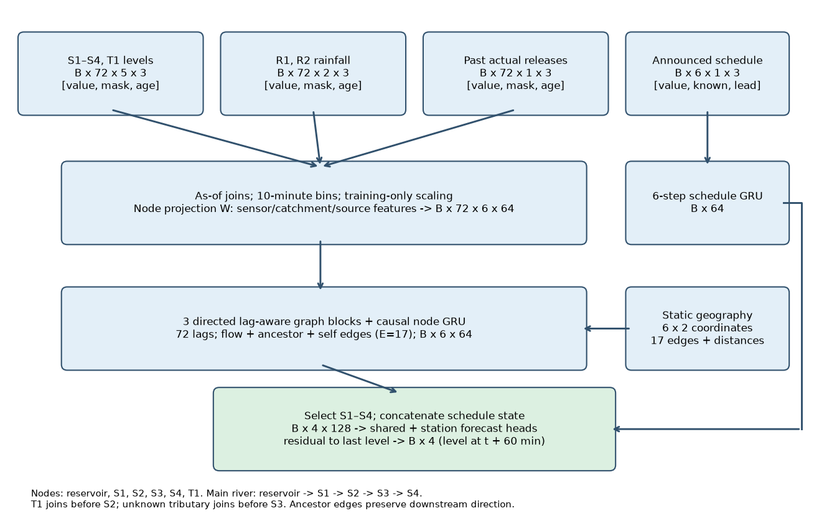
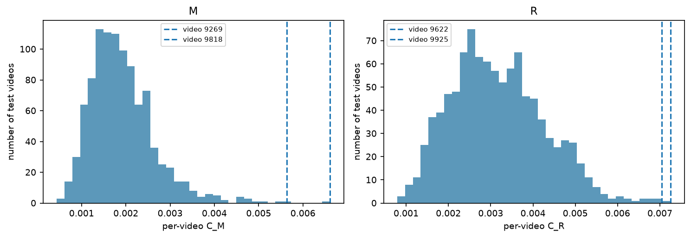
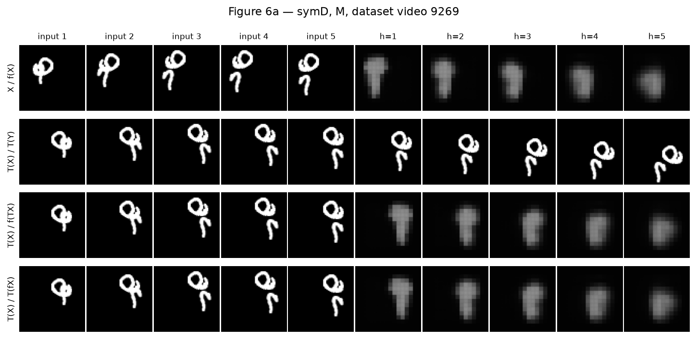
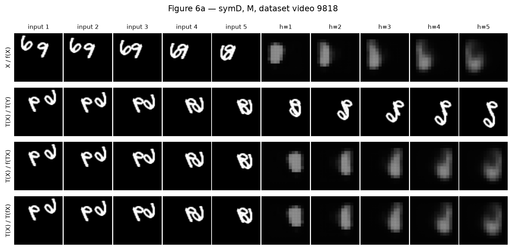
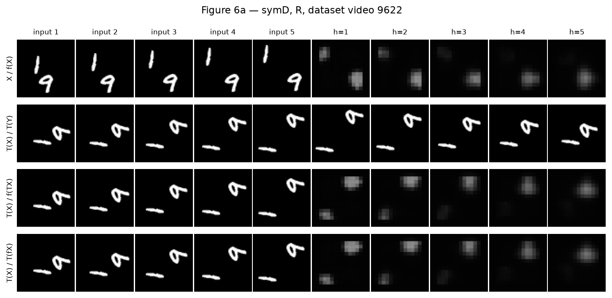
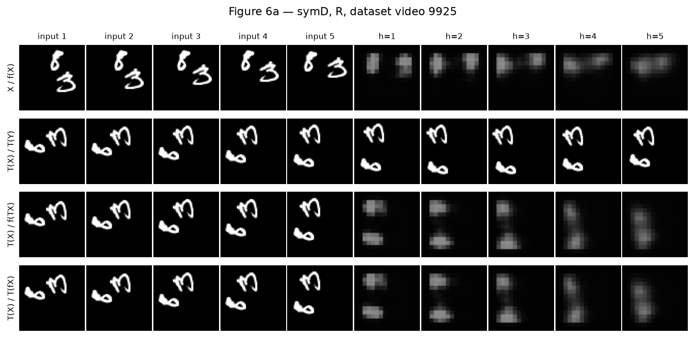
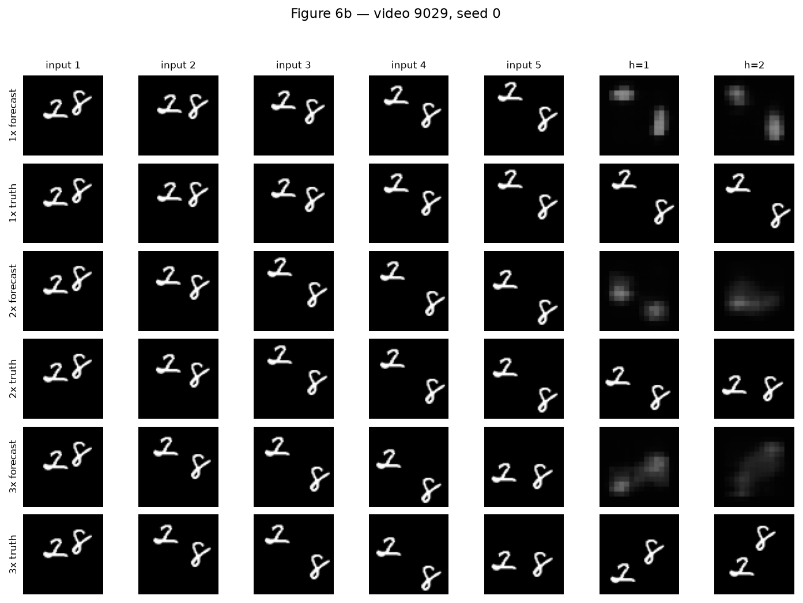

# Motion or Memory?

## AI651 — Deep Learning for Space, Time and Graphs

Assignment 2 | River forecasting proposal and Moving MNIST experiments | Prepared for Zain | 29 October 2026 (Asia/Karachi).

Code repository: local Git repository in zain_projects_practice/DL4STG_PA2. Public GitHub URL: not configured. This report does not claim that a public repository has been created or that an LMS submission has occurred. Publication of the code and inclusion of its URL on this page remain submission steps.

All required models A–D were trained for 30 epochs with seeds 0 and 1. The final model is symmetrised D, with no additional training. Every model metric below uses the 1,000 held-out videos, except Table 1 synthetic checks, Figure 1 training-only optical flow, parameter counts and timings. Tables use mean (seed 0, seed 1); deterministic references use a single value. Errors are rounded to three significant figures, with scientific notation below 1e-3. Underlying unrounded results are included in artifacts/.

The report includes six numbered experimental tables, six numbered experimental figures (some multi-panel), all Q2.1–Q2.17 answers, a causal forecasting proposal, GIFs and a record of the AI assistance. Pre-experiment predictions were committed before the corresponding experiments; their exact text and commit history are retained.

# Question 1 — River Forecasting Proposal

## 1. Architecture diagram

## 2. Assumptions

A1. At least two complete hydrological years of ten-minute records are available, including some floods. This is an assumption about data volume, not a supplied fact. With less data, shrink the network and report wider uncertainty; flood performance cannot be promised.

A2. Measurement time, arrival time and schedule announcement time can be recovered. A reading is usable only when it arrived by issuance. If historical arrival times are absent, impose a conservative fixed delay and state that backtest realism is limited.

A3. Units, station datums and clock conventions can be reconciled. Standardise each continuous feature using training-period statistics; datum changes require explicit correction, since an apparent jump is not river dynamics.

A4. A 12-hour history (72 bins) captures the main dependencies relevant to a one-hour forecast. This is a tunable operational assumption, validated chronologically; extend it if slow propagation exceeds 12 hours.

A5. Dominant transport follows the supplied downstream river topology, with no strong reverse backwater effect over this horizon. Thus upstream-to-downstream edges are justified. If tides/backwater matter, add documented reverse edges and boundary levels; the present graph would otherwise be misspecified.

A6. Travel times vary but relevant delays can be represented within the 72-bin lag bank. Do not equate station index with distance or impose a single unknown travel speed. Distances and recent levels condition learned lag weights.

A7. Rain gauges provide imperfect catchment proxies; they do not measure future rainfall. Soft catchment weights use gauge locations and learned corrections. Unmonitored inflow remains partly unobservable, especially for S3 and S4.

A8. Future schedules available at issuance have predictive value but are not guarantees of actual releases. A known/unknown flag and lead-time features distinguish genuine zero releases from absent schedules.

A9. Reporting latency is usually below one ten-minute interval and short outages occur. Masks and ages are mandatory; severe station outages activate a conservative persistence fallback and an operator flag. A continuously staffed flood operation and a historical alert threshold register are assumed for deployment.

Supplied facts: levels at five stations, two located rain gauges, past releases and pre-announced schedules, station locations/connectivity/distances, ten-minute issuance, and one-hour predictions at S1–S4. No dataset, precise travel times, unmonitored tributary inflow or future rainfall is supplied.

## 3. Forecasting task and data specification

Let t be the wall-clock issuance on the ten-minute grid. Use bins ending t-710,...,t minutes (H=72); missing latest values remain missing. Predict the instantaneous/station-reported level y_i(t+60), i in {S1,S2,S3,S4}, not an average over the next hour. B is the batch size; historical lag, node, channel and future-lead axes are distinct.

## Input/output specification

| Quantity | Shape / axes | Time and availability |
|---|---|---|
| Water levels | B x 72 x 5 x 3; [value,mask,age] | S1–S4,T1; measurement <= t and arrival <= t |
| Rainfall | B x 72 x 2 x 3; [depth,mask,age] | R1,R2; causal ten-minute accumulation; arrival <= t |
| Actual reservoir release | B x 72 x 1 x 3 | Past effective bins, recorded/arrived by t |
| Future release schedule | B x 6 x 1 x 3; [release,known,lead] | Effective t+10,...,t+60; latest announcement <= t per effective bin |
| Static graph/geography | 6 nodes, E=17 directed/self edges; node coordinates and catchment links | 4 main-river edges, T1->S2, 6 self edges, 6 main-river ancestor shortcuts |
| Node embeddings | B x 72 x 6 x 64 | Causal projection of aligned inputs and static features |
| Target / output | B x 4, station axis S1–S4 | Target level at t+60; observed later, never an input |

Use a canonical time zone and event-time bins. Aggregate rain depth by summation, release by interval mean and level by the latest valid reading within a bin; never interpolate from a later reading. At every historical issuance rebuild the as-of view, including superseded schedule versions. A gap may carry forward the last value only with mask=0 and increasing age. Fit normalisation and imputation constants on training data only. Split chronologically, keep events intact, and purge at least history plus horizon at split boundaries.

## 4. Model computations and design justification

Let v denote one of six graph nodes, i a forecast station, s an observed bin, r a lag and a_uv the fixed downstream/self adjacency. z_v,s = W_v [aligned levels, gauge-weighted rain, actual release, masks, ages, static features] + b_v in R^64. Zero-fill missing normalised values only after adding mask and age; nonlocal station levels are not silently copied into every node. Rainfall at a node is sum_j w_vj rain_j, with nonnegative catchment weights informed by locations and learned from historical data.

Lag-aware block: e_uvrs = phi(z_v,s, z_u,s-r, river_distance_uv, r); alpha_uvrs = softmax over allowed upstream u and causal lags r in 0..71; m_v,s = sum_(u,r) alpha_uvrs W_msg z_u,s-r. Invalid or unavailable lag positions are masked. h_v,s = GRU([z_v,s,m_v,s], h_v,s-1). Repeat three graph/temporal blocks with residual projections. The fixed 17-edge graph contains five direct flow edges, six self edges and six main-river ancestor shortcuts (reservoir->S2,S3,S4; S1->S3,S4; S2->S4). Ancestor edges encode hydrological reachability, not instantaneous transport; learned lags still determine timing. They prevent a four-edge reservoir-to-S4 path from exceeding the three-block spatial reach. T1 can reach S4 through its three direct downstream edges.

The schedule GRU encodes six issued future release entries into q_t in R^64; missing schedule bins retain a known flag. Select h_i,t for S1–S4 and concatenate q_t, producing B x 4 x 128. A station-conditioned head gives delta_i = MLP_i([h_i,t,q_t]); yhat_i(t+60) = last_valid_level_i(t) + delta_i. If there is no valid level in the history, use a training-period datum fallback and flag it. Shared features improve data efficiency, while station heads allow different rating/response relationships. The delta skip reduces the burden of learning near-persistence.

Train with L = (1/(4B)) sum_(b,i) |yhat_bi-y_bi| on available labels, normalising per video/issuance by the number of valid stations. If all four labels are present this is ordinary MAE; batches without a valid station label are excluded. Report level MAE/RMSE by station, lead (here fixed at one hour), flood/nonflood strata and event. Use chronological validation to tune width/history and compare against last level and a linear autoregression. Do not infer hydraulic conservation from a learned graph: graph direction/catchment assignment are physical assumptions, but delay weights, nonlinear stage responses and rain-to-inflow conversion are empirical mappings.

Upstream levels propagate through directed lag paths; T1 contributes downstream of its junction at S2, and then S3/S4. Rain can affect all corresponding catchments; the missing tributary is represented only through indirect level/rain evidence. Reservoir history captures realised forcing, while the separate schedule context provides planned forcing that a purely historical model would miss. No future rainfall or future measured level appears in any equation.

## 5. Operation and exceptional conditions

(i) Missing observations: retain value/mask/age channels, train with realistic block outages, and avoid treating absent rain or release as zero. Forecast from other nodes when possible. If S1–S4 are all stale beyond a validated outage threshold, issue a flagged persistence forecast with expanded empirical error bands rather than an unqualified network value.

(ii) Delayed observations: use arrival-time filtering; an observation stamped before t but arriving after t is unavailable for this forecast. Incorporate it at the next issuance and replay causal history if needed. Backtests must mimic this rule, including the same delayed-data policy.

(iii) Announced future releases: select only schedule versions announced by t. Map their effective periods to the six future bins, using duration-weighted rates for partial bins and preserving unknown flags. A release announced after t is excluded even if effective within the forecast horizon.

(iv) Scheduled versus actual releases: retain separate fields and never overwrite a historical schedule with the realised future release. At the next issuance update actual-release history; learn residual schedule error statistics by lead and operator regime. Simulate plausible deviations for stress scenarios, label them as scenarios and widen conditional residual bands. Schedule forecasts can fail when operations deviate abruptly.

Every ten minutes, fetch the as-of snapshot, validate, update encoders, score four stations and log both input version IDs and forecasts. Six nodes, 72 bins and width 64 give a small bounded graph; even all-node causal lag mixing is at most O(B H^2 E d) and the chosen sparse graph reduces constants. This is plausibly feasible within ten minutes, but no latency benchmark is claimed. Require a deployment latency/load test, monitoring, an input deadline and fallback if ingestion or inference misses the deadline.

## 6. Uncertainty, limitations, and additional information

## Limitations and requested information

| Issue / request | Forecast impact and response | Usable without? |
|---|---|---|
| Unmonitored tributary; request a gauge or inflow estimate | Unseen surges can bias S3/S4 low. Use indirect rain/level evidence and flag wet events; irreducible uncertainty remains. | Yes, with explicit blind spot |
| Changing travel times; request flow, channel cross-sections, roughness | Lag attention can adapt to level regime but may extrapolate poorly in extreme floods. Validate eventwise; distances alone do not identify delays. | Yes; lag bank remains empirical |
| Rainfall coverage; request radar, catchment boundaries, forecast rain | Two gauges miss spatial storms; no available-at-issuance future rain means flood growth can be missed. Add forecasts only with archived issue times. | Yes, degraded storm lead |
| Operational deviations; request schedule revisions and actual release logs | Announcement/effective/arrival histories prevent leakage and quantify schedule reliability; emergency changes remain unpredictable. | Yes; unknown schedules masked |
| Quality and latency; request datum changes, maintenance, arrival logs | Spikes and stale readings distort levels and delay inference. QC, outage augmentation, masks and fallback help. | Conditional; reliable timestamps/units essential |
| Rare extremes and regime shifts; request long records and event labels | Global MAE can hide peak failure. Event-stratified assessment and drift monitoring are required. | Yes for monitored pilot; extreme-flood claims unvalidated |
| Backwater/tides; request downstream controls, boundary levels | Reverse effects violate A5; add edges and forcings if documented. | Conditional on A5 validity |
| Uncertainty calibration; request operational alert thresholds | Use rolling held-out signed residual quantiles per station/regime around point forecast for empirical 80/95% intervals. Coverage under shift is not guaranteed; validate peaks and recalibrate. | Yes; report levels and bands, avoid uncalibrated probabilities |

This is a design proposal, as requested: no river data, river training result, guaranteed flood probability or measured deployment latency is claimed. Empirical residual intervals describe observed errors and do not resolve unseen tributary forcing or guarantee coverage during unprecedented events.

# Question 2 — Motion or Memory?

## Protocol and implementation

Hardware: NVIDIA RTX 6000 Ada Generation; CUDA 12.6; PyTorch 2.7.1+cu126; CUDA_VISIBLE_DEVICES=2. Float32 training/inference, TF32 disabled, four CPU threads, cuDNN autotuning enabled. Bitwise cross-platform determinism is not claimed. Seeds control weights, video shuffling, windows and augmentation. Training uses Adam lr=0.001, batch size 32, 30 complete shuffled passes over 8,000 videos (250 batches/epoch), no schedule, final-epoch weights. Loss averages valid pixel/frame errors within each video, then videos equally. No teacher forcing, AMP, test-based selection or early stopping is used.

Dataset: torchvision MovingMNIST(split=None), official file with MD5 be083ec986bfe91a449d63653c411eb2; only transport was upgraded to HTTPS. Video indices 0–7999 train, 8000–8999 validation and 9000–9999 test. D was fixed analytically before tests; no candidate selection used test or validation. Float32 frames are divided by 255. Training starts: A/B uniform 1–11 at 1x; C/D speeds uniform {1,2,3}, starts uniform 1–14,1–8,1–2 respectively. B samples one uniform square symmetry per window. Extra predictions always exist but unavailable targets are masked. Every cross-speed comparison uses E(2).

The exact baseline uses pixel-unshuffle(4), two biased 3x3 ConvLSTM cells of width 64, a biased 1x1 64->16 head, pixel-shuffle(4) and sigmoid. The gates follow the supplied no-peephole equations. Nine recurrent steps consume five observations and four own predictions; only step 5–9 outputs are scored. Gradients flow through feedback. Model D changes layer 2 dilation to 2 with padding 2; layer 1 remains dilation 1. No other architecture or protocol changes are made.

## Table 1 — Exact transformation and window checks

| Check | Expected | Measured |
|---|---|---|
| a | 0; equal=True | 0; equal=True |
| b | 0; equal=True | 0; equal=True |
| c | 0; equal=True | 0; equal=True |
| d | (7,10,43) | [7, 10, 43] |
| e | (7,43,10) | [7, 43, 10] |
| f | 1–5 / 6–10 | [1, 2, 3, 4, 5] / [6, 7, 8, 9, 10] |
| g | 1,3,5,7,9 / 11,13,15,17,19 | [1, 3, 5, 7, 9] / [11, 13, 15, 17, 19] |
| h | 1,4,7,10,13 / 16,19 | [1, 4, 7, 10, 13] / [16, 19] |

## Q2.1 — Familiarity of motion

Figure 1(a) spreads probability across the circle; the total variation from a uniform 18-bin distribution is 0.11. Mirroring maps theta to (180-theta) modulo 360; anticlockwise rotation maps theta to theta+90. A broadly uniform directional distribution makes both sets of trajectories broadly familiar, even though digit appearance is different. Figure 1(b)'s typical speed is 3.32; 2x and 3x correspond roughly to 6.64 and 9.95 pixels per observed frame. These multiples describe unreflected constant-velocity segments; bounces and optical-flow estimation can reduce net displacement. Overlap, the two-frame brightness mask and the >0.5 threshold bias this pixel-weighted estimate; it is not a ground-truth per-digit velocity distribution. Without an overlap-free sensitivity analysis we cannot rule out a change in detailed directional weights, though broad directional coverage is visible.

The histogram is not invariant: recomputing the same 20-degree-bin histogram after mapping the measured angles gives total variation 0.132 under mirror and 0.2 under rotation relative to the original. Thus mirrored and rotated directions are represented, but their frequencies are not identical in this finite sample. Rotation in particular introduces a measurable motion-statistics shift as well as an appearance shift; this limits causal attribution to appearance alone.

## Q2.2 — Controlled transformations

Mirror and rotation preserve physical motion validity and speed magnitude but transform direction, wall orientation and digit appearance. If the direction distribution is approximately isotropic, their major distribution shift is appearance/orientation, rather than an entirely new motion law. Speed-up preserves each sampled digit appearance but changes displacement and temporal aliasing, including possible unobserved bounces. Thus these interventions probe complementary vulnerabilities; they do not perfectly isolate appearance because the learned representation and boundary response can also be orientation-sensitive.

## Table 2 — Original 1x baseline

| Metric | A: mean (s0,s1) | Blank | Copy-last |
|---|---|---|---|
| MSE 1 | 0.0169 (0.0171, 0.0167) | 0.0426 | 0.0492 |
| MSE 2 | 0.0204 (0.0206, 0.0203) | 0.0426 | 0.0604 |
| MSE 3 | 0.0227 (0.0229, 0.0226) | 0.0426 | 0.0669 |
| MSE 4 | 0.0245 (0.0247, 0.0244) | 0.0425 | 0.0708 |
| MSE 5 | 0.0262 (0.0264, 0.0261) | 0.0425 | 0.0732 |
| E(5) | 0.0222 (0.0223, 0.022) | 0.0426 | 0.0641 |
| Parameters | 480,784 | 0 | 0 |

![Figure 2. Seed-0 A, original 1x, videos [9000, 9001, 9002]; upper row in each pair is five inputs then predictions, lower is inputs then truth. Video 9002 was selected for merging/separating foreground components as an overlap example. All indices are global dataset indices.](figures/Figure2.png)

## Q2.3 — One-step reach of A

One folded-grid cell is 4 original pixels centre-to-centre. Each 3x3 gate convolution extends spatial radius by one cell. The input u_tau can reach the output through the layer-1 gate convolution and then the layer-2 gate convolution: radius 2 cells, or 8 original pixels per coordinate (Chebyshev radius). The same longest path exists from h1_(tau-1) through both convolutions; h2_(tau-1) traverses only the second, for radius 4 pixels. Cell-state updates are pointwise and do not add reach. The 1x1 head and shuffle operations add none. Recurrence accumulates reach over time, but those earlier steps are not counted inside this one update. At a diagonal the Euclidean centre distance can be 8*sqrt(2) pixels; the stated 8 is the axis/Chebyshev convention used to compare displacements.

## Q2.4 — Baseline accuracy and overlap

Table 2 gives A E(5)=0.0222 (0.0223, 0.022), versus Blank 0.0426 and Copy-last 0.0641. A's MSE changes from 0.0169 (0.0171, 0.0167) at h=1 to 0.0262 (0.0264, 0.0261) at h=5. Figure 2 makes the horizon-dependent localisation and sharpness error visible. Pixel MSE rewards an averaged, blurry forecast when digit position or overlap identity is uncertain; successful low MSE does not establish that individual digits are tracked through occlusion.

In Figure 2 video 9002, the true 1-like stroke meets the top of the 5-like digit near the last displayed future frames. A blurs away the lower digit structure and spreads intensity between the two objects; by h=5 the two-digit scene is represented as a diffuse near-vertical cloud. This specific overlap example does not show successful recovery of two digit identities after occlusion.

## Q2.5 — Prediction recorded before baseline transformation/speed tests

I predict model A will be approximately, but not exactly, mirror-consistent; rotation will be harder because digit appearance changes more. Its longest one-step centre-to-centre reach is 8 original pixels, whereas the measured typical speeds are 3.32, 6.64, and 9.95 pixels per observed frame at 1x, 2x, and 3x. I expect quality to deteriorate at 2x and more strongly at 3x, especially for individual displacements above 8 pixels; reach alone is not a hard accuracy threshold.

The paragraph above is copied without editing from predictions/Q2_5.md; the experiment committed it before running the mirror/rotation/speed evaluation. See prediction_commits.txt for commit hashes and timestamps.

## Table 3 — Baseline consistency and correctness

| Metric | A: mean (s0,s1) | Blank | Copy-last |
|---|---|---|---|
| E5 | 0.0222 (0.0223, 0.022) | 0.0426 | 0.0641 |
| CM | 0.00199 (0.00192, 0.00205) | 0 | 0 |
| EM | 0.0229 (0.0231, 0.0227) | 0.0426 | 0.0641 |
| CR | 0.0032 (0.00318, 0.00322) | 0 | 0 |
| ER | 0.024 (0.0241, 0.0239) | 0.0426 | 0.0641 |

## Q2.6 — Consistency alone is insufficient

Blank always produces zero, and spatial transformation of zero remains zero. Copy-last simply selects and repeats the last frame, which commutes exactly with a spatial permutation. Their CM=CR=0 in Table 3 is therefore compatible with poor forecasts. C_T measures agreement between two predictions, not agreement with reality; E_T must accompany it. A consistently stationary or blurry forecast is not evidence of learned motion.

## Q2.7 — A specific disagreement

Consider dataset video 9622, Figure 3(R, rank 1). Rows 3 and 4 compare predicting after rotation against rotating the original prediction: their per-video squared disagreement is 0.00725. For the direct rotated-input prediction, peak intensity changes from 0.838 at h=1 to 0.654 at h=5, versus true-frame peaks 1 and 1. Its foreground intensity mass changes from 237 to 306, versus truth 200 to 200. The panel shows the corresponding spatial disagreement: the two routes fail to maintain the same sharply localised moving-digit support. These are representation/localisation failures; the figure alone does not establish a particular incorrect bounce law or object identity assignment.

Visual inspection of video 9622: in row 3 the rotated 9-like digit broadens vertically by h=4–5 and leaves an extra diffuse blob below it, while the short horizontal 1-like stroke splits and fades into two low-intensity pieces. In row 4 the upper digit instead spreads into a wide horizontal wedge and the lower stroke becomes a larger cloud toward the bottom-left. Both disagree with the two sharply separated true digits in row 2. Thus the transformation changes both predicted shape and localisation; neither route maintains a reliable two-object account.

## Q2.8 — Rotation versus mirror

For A at 1x, transformed errors are EM=0.0229 (0.0231, 0.0227) and ER=0.024 (0.0241, 0.0239); rotation is harder by the two-seed mean transformed error. The corresponding gaps CM=0.00199 (0.00192, 0.00205) and CR=0.0032 (0.00318, 0.00322) quantify consistency separately. Broad direction coverage in Figure 1 weakens a pure unfamiliar-direction explanation; altered digit orientation and the architecture's orientation-sensitive features are plausible drivers. This is evidence consistent with appearance sensitivity, not a causal proof that appearance alone explains the difference.

## Table 4 — Baseline speed stress test

| Metric / speed | A: mean (s0,s1) | Copy-last |
|---|---|---|
| E2_1 | 0.0187 (0.0189, 0.0185) | 0.0548 |
| E2_2 | 0.0461 (0.0453, 0.0469) | 0.0661 |
| E2_3 | 0.0547 (0.0549, 0.0545) | 0.0703 |
| E5 | 0.0222 (0.0223, 0.022) | 0.0641 |
| E5_2 | 0.0512 (0.05, 0.0523) | 0.0719 |

![Figure 5. Seed-0 A, video 9029; inputs and h=1,2 prediction/truth at all three speeds. The same video is reused in Figure 6(b). All displayed true frames have two foreground components above intensity 0.05 (area >12 pixels) whose bounding boxes are separated by at least three pixels; global frame numbers inspected: [1, 2, 3, 4, 5, 6, 7, 9, 10, 11, 13, 16, 19].](figures/Figure5.png)

## Q2.9 — Speed failure and reach

A's E(2) is 0.0187 (0.0189, 0.0185) at 1x, 0.0461 (0.0453, 0.0469) at 2x, and 0.0547 (0.0549, 0.0545) at 3x (Table 4). Figure 5 shows how the same video changes under temporal subsampling. Larger displacement makes localisation and sharpness harder, but an 8-pixel structural reach is not a guaranteed speed threshold: velocities vary, diagonal versus axial distance matters, and previous recurrent updates can retain information. A visible blur suggests conditional averaging; stalling suggests copying/persistence; duplication suggests incompatible positional hypotheses; disappearance suggests loss of a digit representation. None alone proves a reach bottleneck. We therefore describe the measured deterioration rather than declaring failure at a universal speed.

In Figure 5 video 9029, A loses the internal shape of the 8-like digit even at 1x. At 3x its two futures are two diffuse blobs clustered near the preceding scene, whereas the true 2-like digit moves far down and left and the 8-like digit is sharply separated above/right. The lower-left displacement is substantially under-predicted: this is a combination of stalling and blur, with no visible duplicate digit needed to explain this example. There is already a large measured deterioration at 2x, where typical displacement is below the nominal 8-pixel reach, showing that reach alone missed the training-distribution and representation problem.

## Q2.10 — Separate unfamiliar speed from reach

A alone cannot distinguish the two. Train C on the uniform speed mixture using exactly A architecture and protocol, then compare to A by E(2) at each speed. Improvement implicates training distribution. Compare C with D on the same mixture and budget to test a larger-reach architecture. For stronger attribution, bin by independently measured nonoverlapping displacement relative to the respective reaches and use several matched-capacity receptive-field designs; dilation also changes spatial sampling and optimisation, so C versus D is not a perfect intervention on reach alone.

## Q2.11 — Prediction recorded before B–D training

I predict B will reduce mirror and rotation inconsistency and transformed error, but may sacrifice some original-clip accuracy. C should improve fast-motion forecasts by exposing the baseline to speeds 2x and 3x, while symmetry remains unconstrained. D increases one-step reach from 8 to 12 pixels and should improve over C for larger displacements, although bounces, overlaps, and optimisation may prevent a complete fix.

The paragraph above is copied without editing from predictions/Q2_11.md, committed after the baseline tests and before B–D training. No model was retrained or chosen using test performance.

## Table 5 — What data and reach change

| Metric | A | B | C | D |
|---|---|---|---|---|
| E(5), 1x | 0.0222 (0.0223, 0.022) | 0.0224 (0.0229, 0.022) | 0.027 (0.0273, 0.0268) | 0.0272 (0.0273, 0.0272) |
| C_M | 0.00199 (0.00192, 0.00205) | 0.00113 (0.00108, 0.00119) | 0.0011 (8.62e-04, 0.00134) | 7.87e-04 (7.97e-04, 7.76e-04) |
| E_M | 0.0229 (0.0231, 0.0227) | 0.0224 (0.0229, 0.0219) | 0.0272 (0.0275, 0.027) | 0.0274 (0.0275, 0.0273) |
| C_R | 0.0032 (0.00318, 0.00322) | 0.00149 (0.00146, 0.00151) | 0.00204 (0.00181, 0.00227) | 0.00193 (0.0018, 0.00206) |
| E_R | 0.024 (0.0241, 0.0239) | 0.0224 (0.0229, 0.0219) | 0.028 (0.0282, 0.0279) | 0.0283 (0.0284, 0.0283) |
| E(2), 1x | 0.0187 (0.0189, 0.0185) | 0.0186 (0.0189, 0.0183) | 0.0232 (0.0233, 0.0231) | 0.0244 (0.0245, 0.0244) |
| E(2), 2x | 0.0461 (0.0453, 0.0469) | 0.0449 (0.0447, 0.045) | 0.0287 (0.0291, 0.0283) | 0.0288 (0.029, 0.0286) |
| E(2), 3x | 0.0547 (0.0549, 0.0545) | 0.0513 (0.0514, 0.0511) | 0.0334 (0.0336, 0.0333) | 0.0325 (0.0325, 0.0326) |
| Parameters | 480,784 | 480,784 | 480,784 | 480,784 |
| Train sec/epoch | 5.24 (5.26, 5.22) | 5.81 (5.94, 5.68) | 5.2 (5.22, 5.18) | 5.1 (5.09, 5.1) |
| Inference sec/1000 | 0.171 (0.182, 0.159) | 0.163 (0.163, 0.162) | 0.163 (0.163, 0.164) | 0.164 (0.17, 0.158) |

Parameter counts are exact (480,784 for each model; the repeated seed formatting is retained for consistency). Training times are the wall-clock mean of all 30 epochs, excluding download; per-epoch checkpoint writing is outside the timer. Inference times include GPU synchronisation around every batch, after float32 batches reach the device, under eval/no_grad; one warm-up batch is excluded. At batch 32 the final batch contains 8 videos. Time variability is shown by seed, not interpreted as a causal accuracy effect.

## Q2.12 — Model D and its larger reach

D retains patch size 4, 64 hidden channels and every baseline layer. Layer 1 uses 3x3 dilation 1 (radius 1 folded cell), while layer 2 uses 3x3 dilation 2 (radius 2 folded cells), with padding 2 so shapes are unchanged. The longest within-step path from u_tau or h1_(tau-1) through both gate convolutions has radius (1+2)*4=12 original pixels per coordinate, strictly above A/C at 8; the path from h2_(tau-1) has radius 8. Pointwise memory and the head add none. Combining layer-1 offsets {-1,0,1} with layer-2 offsets {-2,0,2} covers every integer offset -3..3 per coordinate, avoiding holes on the longest path. D has exactly 480,784 parameters, below the 721,176 cap. Its Euclidean diagonal maximum is 12*sqrt(2).

## Q2.13 — Attribution supported by comparisons

Appearance/orientation: compare A with B, whose only intervention is uniform square-symmetry augmentation. EM changes from 0.0229 to 0.0224 and ER from 0.024 to 0.0224; CM/CR remain learned rather than guaranteed. These comparisons measure orientation-sensitive generalisation, with the caveat about directional statistics in Q2.8. Unfamiliar motion: compare A with C, E(2) at 3x 0.0547 -> 0.0334; improvement shows that training exposure can help without changing reach. Architectural reach: compare C with D on the identical mixture, E(2) at 3x 0.0334 -> 0.0325. Only if D clearly improves is this evidence for a benefit of the larger-reach architecture; if it does not, the experiment does not justify labelling the residual error a demonstrated reach bottleneck. Two seeds describe variability and do not establish statistical significance.

If C remains poor at 3x while D is strong, that supports a limitation of the original spatial update, subject to the changed dilation/optimisation caveat. More data can change weights but cannot make a one-step computation depend on an input outside its structural support. It can still improve use of earlier recurrent information, so “more data cannot fix anything” would be too strong. Residual bounce, overlap and long-rollout errors may have mixed or unresolved causes rather than one exclusive label.

## Q2.14 — Cost on ordinary clips

Original 1x E(5), Table 5: B: 0.0224 (+1.11% vs A), C: 0.027 (+22% vs A), D: 0.0272 (+22.8% vs A). A positive percentage is an accuracy cost. The tradeoff is worthwhile only if the deployment values orientation robustness and faster motion enough to accept that cost; this benchmark prioritises both, so the final model follows the specified D design rather than selecting a winner from the test set.

## Built-in symmetry: short proof

Let rho(g) act by spatial pixel permutation and define fbar(X)=(1/8) sum_g rho(g)^(-1) f(rho(g)X). For any a in G, set h=ga; then g=h a^(-1) and g^(-1)=a h^(-1). Hence fbar(aX)=(1/8) sum_h a h^(-1) f(hX)=a fbar(X). Mirror and rotation are elements of G, so both consistency gaps are exactly zero in real arithmetic for any underlying f. The proof needs the complete group and correct inverses; for g=MR^a the inverse is itself, while (R^a)^(-1)=R^(-a). Floating-point addition in different orders can leave tiny nonzero squared gaps.

## Table 6 — Symmetrised models (final = symD)

| Metric | symB: mean (s0,s1) | symD / final: mean (s0,s1) |
|---|---|---|
| E(5), 1x | 0.0218 (0.0223, 0.0213) | 0.0272 (0.0273, 0.0271) |
| C_M | 4.41e-17 (4.14e-17, 4.69e-17) | 3.15e-17 (3.06e-17, 3.25e-17) |
| E_M | 0.0218 (0.0223, 0.0213) | 0.0272 (0.0273, 0.0271) |
| C_R | 4.51e-17 (4.23e-17, 4.79e-17) | 3.24e-17 (3.15e-17, 3.33e-17) |
| E_R | 0.0218 (0.0223, 0.0213) | 0.0272 (0.0273, 0.0271) |
| E(2), 1x | 0.0182 (0.0185, 0.0179) | 0.0244 (0.0245, 0.0244) |
| E(2), 2x | 0.044 (0.0439, 0.0441) | 0.0289 (0.0291, 0.0287) |
| E(2), 3x | 0.0499 (0.0503, 0.0496) | 0.0324 (0.0324, 0.0325) |
| Parameters | 480,784 | 480,784 |
| Train sec/epoch | 5.81 (5.94, 5.68) | 5.1 (5.09, 5.1) |
| Inference sec/1000 | 1.31 (1.3, 1.31) | 1.28 (1.28, 1.28) |

The final model is symmetrised D as specified in the handout. Optional D+B was not trained. The training-time entries copy the corresponding B or D time exactly; symmetrisation requires no additional training. Wrapped inference includes all eight input transforms, forward passes, inverse transforms and averaging; gaps are reported in scientific notation. Original and transformed correctness errors are always shown next to consistency.

## Q2.15 — Learned versus built-in symmetry

B learns from augmented examples but its gaps are CM=0.00113 (0.00108, 0.00119) and CR=0.00149 (0.00146, 0.00151). SymB reduces them to 4.41e-17 (4.14e-17, 4.69e-17) and 4.51e-17 (4.23e-17, 4.79e-17) by algebraic construction, independently of training success. Correctness still needs evaluation: B E(5)=0.0224 (0.0229, 0.022), symB=0.0218 (0.0223, 0.0213); D=0.0272 (0.0273, 0.0272), symD=0.0272 (0.0273, 0.0271). At 1x the wrapped transformed errors match original errors to numerical precision because the transforms preserve pixel MSE. Inference for D is 0.164 (0.17, 0.158) seconds versus symD 1.28 (1.28, 1.28); it runs eight transformed predictions. Averaging can blur mutually displaced or differently shaped predictions, and can worsen an original orientation where the unwrapped model was especially accurate. Here the observed original E(5) change from D to symD is -0.119%; the sign states whether that harm occurred on the full test set, rather than assuming averaging always helps.

## Q2.16 — Revisit the disagreement video

On the Q2.7 video 9622, the final rotation consistency gap is 2.30e-17 instead of A's 0.00725. Its rotated-truth MSE changes from 0.0317 to 0.0306. Figure 6(a) makes the remaining position/shape errors visible. Symmetrisation fixes agreement between the two transformation routes exactly; agreement does not mean the digit path is correct. Speed exposure and the larger-reach architecture are assessed globally through A/C/D in Table 5; this one final panel cannot uniquely attribute each visible improvement to one of those changes.

No, the final model does not get this example fully right. The 9-like digit remains a diffuse blob rather than a recognisable moving digit, and the short 1-like stroke fades markedly at later horizons. Rows 3 and 4 now agree, but they agree on this incorrect blurred forecast. Figure 6(b) video 9029 similarly retains substantial blur and merges intensity between the two digit locations at 3x. These examples limit any claim that the final model has learned reliable object-level motion.

## Q2.17 — Final verdict (under 150 words)

The final model learns some predictive temporal structure, but does not establish a reliable object-level motion law. Its error improves on Copy-last, while the inspected examples retain severe blur and fading. Exact mirror/rotation consistency comes from group averaging, so it does not prove that D learned the motion rule. A/B and A/C test orientation and speed exposure; C/D tests a larger-reach update under matched data and parameter count. A skeptic should require correct transformed futures, robustness across individual videos, and successful separated-digit, bounce and overlap cases, not a small consistency gap alone. This experiment has not tested new digit families, longer rollouts or unseen acceleration. Tracking accuracy through those shifts would provide stronger evidence of transferable motion learning.

# Reproducibility, limitations and AI-use disclosure

Run from the project root with CUDA_VISIBLE_DEVICES=2 MPLBACKEND=Agg ../../.venv/bin/python experiment.py. The pipeline validates transforms, downloads/checks the official data, trains and checkpoints every epoch, commits the required predictions before tests, evaluates both seeds and generates this report. A file lock prevents duplicate runs. Rerunning resumes final-epoch checkpoints and preserves recorded predictions; move artifacts/checkpoints aside to force a fresh experiment. The validation split was reserved and was not needed to fix the analytic D architecture.

Prediction commit records:
b3edabd98f0754b465bd0468a0fc2567940b36df 2026-10-29T06:31:47+00:00 Record Q2.11 prediction before corresponding experiments
da10f8cbbd4cec6cfda0334d1b0e2f4ad61f07aa 2026-10-29T06:31:37+00:00 Record Q2.5 prediction before corresponding experiments

Limitations: two seeds are not a confidence interval; no significance claim is made. Foreground-component screening identifies candidate overlap/clean examples but does not supply ground-truth digit identities or exact velocities. Optical flow may be biased by overlap and masking. No per-object tracking metric, out-of-family digit test, longer-horizon test or river-data benchmark was run. The Git repository is local; public publication and LMS upload have not been performed. Training wall-clock time includes batch construction and GPU execution, and excludes checkpoint serialisation; it can vary with host contention.

## AI assistance: prompts, outputs and edits

User prompt 1 (verbatim): "Please make a new dir named as zain_projects_practice and we will work inisde of it". Output: the directory was created and used as the project workspace.

User prompt 2 (verbatim): "Now please complete this end to end project for this, you can use GPU = 2 which is free 0 1 2 3 4, you can use 2nd one and remove any process runing on it: Please do everyhting in backgroud, and generate the final report for me please." The supplied archive was DL4STG_PA2.zip.

AI output: Codex inspected the assignment, implemented the data and model pipeline, designed D and the river proposal, generated pre-experiment predictions, ran training/evaluation on GPU 2, and authored this report, figures and GIFs. GPU 2 was idle, so no existing GPU process was terminated. Numerical results are computed from the saved experiments, not invented or copied from external runs. The full generated source, raw metrics, training traces and local Git history accompany the report.

Edits made: the AI upgraded the official Moving MNIST download transport from HTTP to HTTPS without changing the file/MD5; implemented masks for variable target lengths; generated the report from measured artifacts; corrected graph-edge accounting and diagram placement; added the observed directional-imbalance caveat; and reviewed the baseline rotation panel and outputs for protocol consistency. No human edits or independent student verification are asserted. The student should review the derivations, code, figures and results before submission and disclose this assistance under the course policy. This disclosure documents the work performed and does not imply the student independently authored it.

## References

Assignment source: supplied AI651 Fall 2026 Assignment 2 PDF, DL4STG_PA2.pdf. ConvLSTM: Shi et al. (2015), Convolutional LSTM Network: A Machine Learning Approach for Precipitation Nowcasting, NeurIPS. Moving MNIST: Srivastava et al. (2015), Unsupervised Learning of Video Representations using LSTMs, ICML. Dataset API and model operations were inspected from the installed torchvision/PyTorch implementation; no external numerical results were imported.
